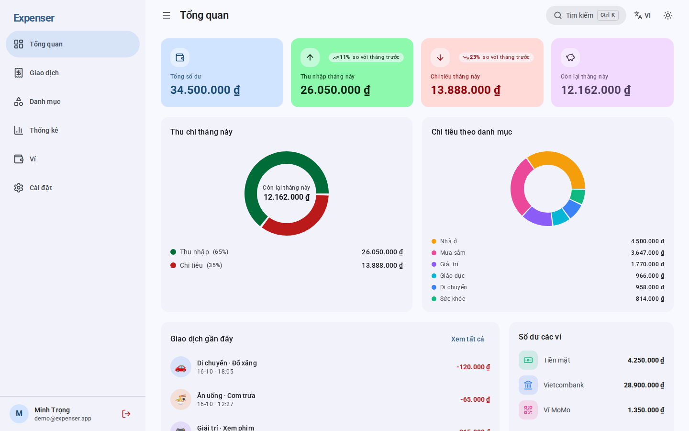
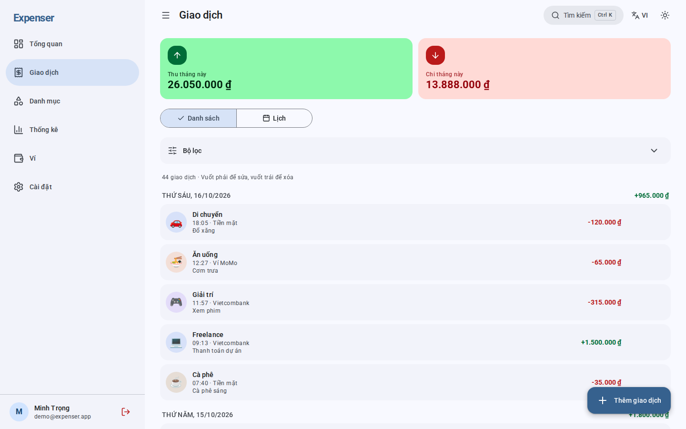
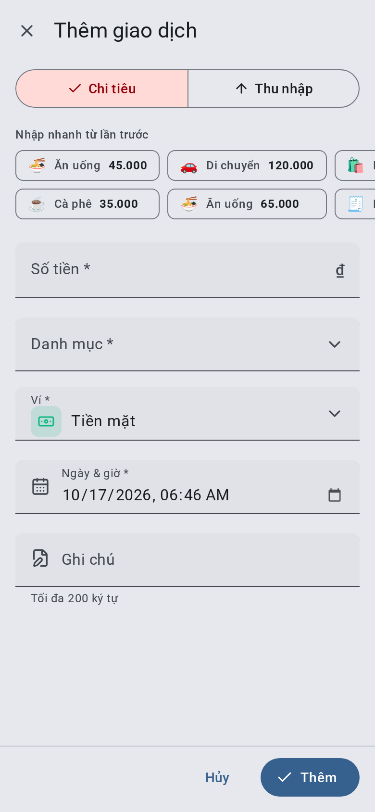
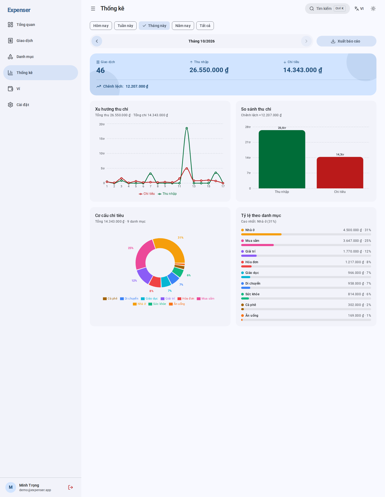
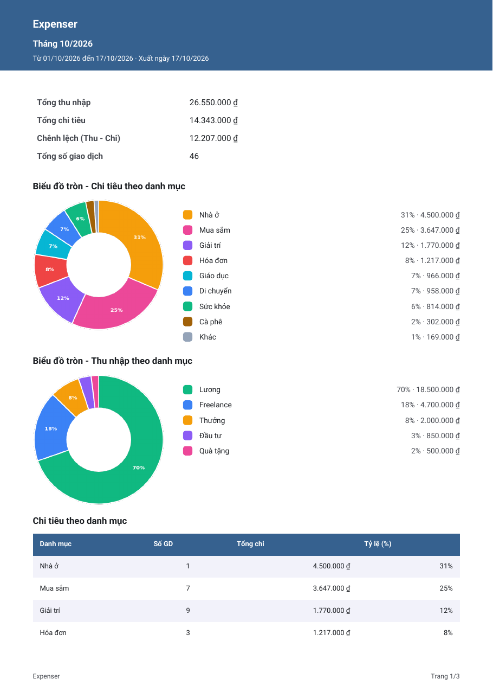
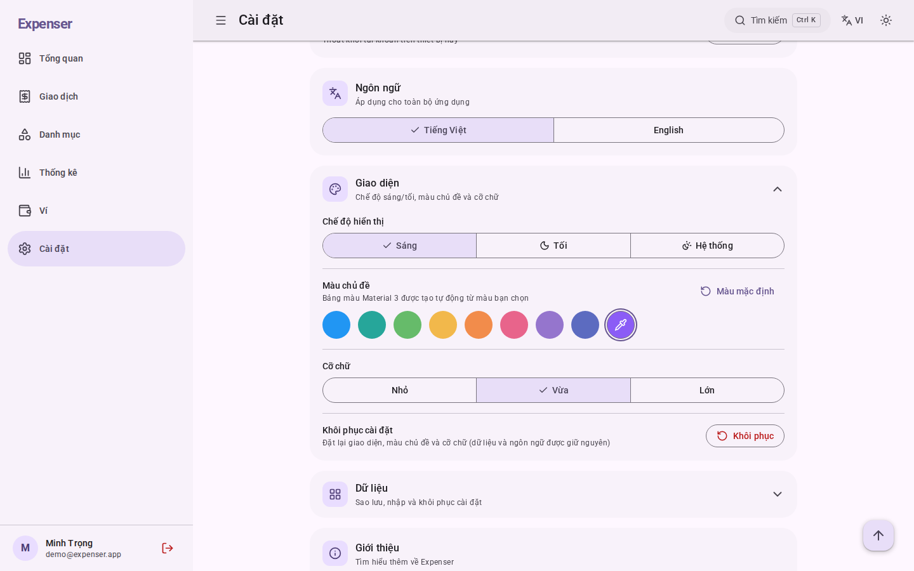
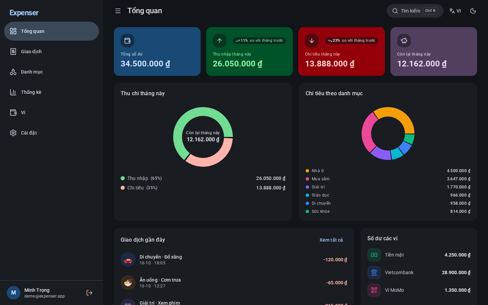
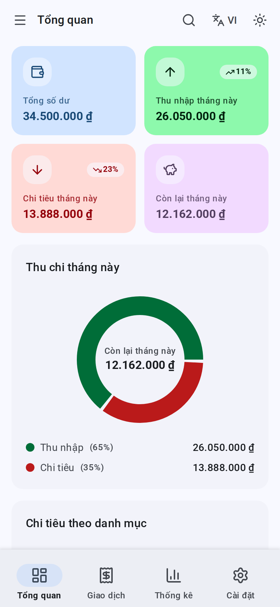
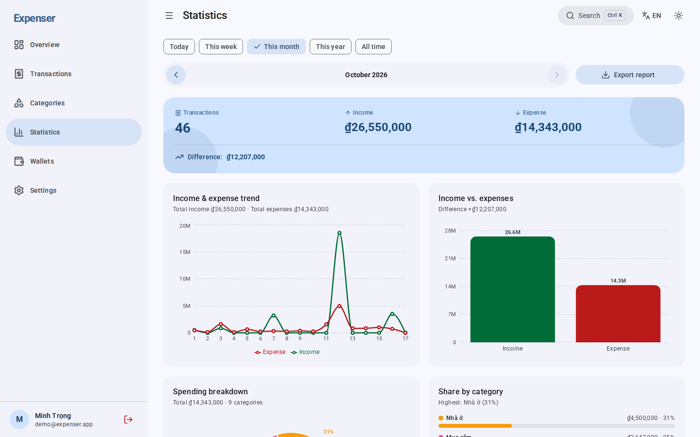

<div align="center">

# Expenser

**Ứng dụng quản lý chi tiêu cá nhân — gọn gàng, đẹp mắt, mã nguồn mở.**
*A free, open-source personal expense tracker with a Material Design 3 interface.*

[](https://expenser-quan-ly-chi-tieu.vercel.app/)


[**Dùng thử**](https://expenser-quan-ly-chi-tieu.vercel.app/) · [**Trang giới thiệu**](https://expenser-quan-ly-chi-tieu.vercel.app/landing.html)

</div>

---

## 📖 Giới thiệu

**Expenser** giúp bạn ghi lại thu chi trong vài giây, theo dõi nhiều ví, xem thống kê trực quan và xuất báo cáo chuyên nghiệp (PDF / Excel / ảnh). Ứng dụng được thiết kế theo **Material Design 3**, ưu tiên thao tác một tay trên điện thoại, cài được như ứng dụng thật (PWA) và vẫn dùng được khi mất mạng.

- 🎨 **Material Design 3** — bảng màu sáng/tối tạo từ file theme của Material Theme Builder, **đổi được màu chủ đề** ngay trong Cài đặt.
- 🌐 **Song ngữ Tiếng Việt / English** — chuyển ngôn ngữ tức thì, ngày giờ và tiền tệ tự định dạng theo ngôn ngữ.
- ⚡ **Nhanh & nhẹ** — tách code theo trang, tải thư viện nặng (biểu đồ, xuất file) khi cần, Firestore có bộ nhớ đệm offline.
- 🔓 **Mã nguồn mở** theo giấy phép MIT.

## 🖼️ Screenshots

> Ảnh đặt trong thư mục [`screenshots/`](screenshots) với tên `image01.png`, `image02.png`, `image03.png`, …

| | | |
| :---: | :---: | :---: |
| <br/>**Tổng quan** | <br/>**Danh sách giao dịch** | <br/>**Thêm giao dịch** |
| <br/>**Thống kê** | <br/>**Báo cáo PDF có biểu đồ tròn** | <br/>**Đổi màu chủ đề** |
| <br/>**Chế độ tối** | <br/>**Giao diện di động** | <br/>**Tiếng Anh** |

## ✨ Tính năng

**Quản lý tài chính**
- **Tổng quan**: số dư, thu/chi tháng này (so với tháng trước), biểu đồ tròn thu/chi tháng này, cơ cấu chi tiêu, giao dịch gần đây, số dư từng ví.
- **Giao dịch**: xem dạng **danh sách** (nhóm theo ngày) hoặc **lịch tháng**; bộ lọc dạng accordion (có nút **Đặt lại bộ lọc**), tìm kiếm, sắp xếp; vuốt phải để sửa / vuốt trái để xóa (trên máy tính có nút sửa/xóa khi rê chuột); tải thêm tự động khi cuộn.
- **Nhập nhanh**: gợi ý các mục đã nhập gần đây — chạm để điền sẵn số tiền, danh mục và ví.
- **Danh mục thu & chi**: thêm/sửa/xóa với emoji tự chọn và màu tùy chỉnh.
- **Nhiều ví**: số dư từng ví và **chuyển tiền giữa các ví**.

**Thống kê & báo cáo**
- Lọc theo **Hôm nay / Tuần này / Tháng này / Năm nay / Tất cả**, kèm điều hướng sang kỳ trước/sau (ngày, tuần, tháng, năm).
- Biểu đồ xu hướng, so sánh thu–chi, **biểu đồ tròn** theo danh mục.
- **Xuất báo cáo PDF / Excel / ảnh PNG**, đều có **biểu đồ tròn** (chi tiêu và thu nhập theo danh mục).
- Nhập / xuất **giao dịch** và **danh mục** riêng biệt (CSV, Excel .xlsx, JSON) và nút **Xuất tất cả** (1 file Excel + 1 file JSON gồm cả hai, cùng 2 file CSV). Nhập hàng loạt rất nhanh nhờ ghi theo lô.

**Trải nghiệm**
- Nút nổi (FAB) chỉ xuất hiện ở trang **Giao dịch** (thêm giao dịch) và **Danh mục** (thêm danh mục), xếp cùng cột với nút **Lên đầu trang** nên không chồng nhau.
- Form nhiều trường (giao dịch, danh mục) mở dạng **sheet toàn màn hình**; form ít trường và hộp xác nhận dùng **dialog** ở giữa; không tự focus vào ô nhập.
- Trang Cài đặt chia thành các mục **accordion** đóng/mở (nhớ trạng thái trong phiên).
- Chế độ **Sáng / Tối / Theo hệ thống**, **màu chủ đề tùy chọn** (8 màu gợi ý + chọn màu bất kỳ), cỡ chữ 3 mức.
- **Bộ lọc từng trang được ghi nhớ** (sessionStorage) khi chuyển trang.
- Tìm kiếm nhanh **Ctrl + K**, hoạt ảnh mượt (ripple, chuyển trang, trượt), hỗ trợ `prefers-reduced-motion`.
- **PWA**: cài lên màn hình chính, dùng offline, đồng bộ lại khi có mạng.
- Truy cập tốt: nhãn ARIA, điều hướng bàn phím, bẫy focus trong hộp thoại.

## 🚀 Cài đặt

**Yêu cầu:** Node.js ≥ 18 và một dự án [Firebase](https://console.firebase.google.com/).

```bash
git clone <repo-url>
cd expenser
npm install
```

**1. Tạo Firebase project**

1. Firebase Console → **Add project**.
2. **Authentication** → *Sign-in method* → bật **Google** (và Email/Password nếu muốn dùng trang `/register`).
3. **Firestore Database** → **Create database**.
4. **Project settings → Your apps → Web app** → sao chép `firebaseConfig`.

**2. Biến môi trường** — sao chép `.env.example` thành `.env` rồi điền:

```env
VITE_FIREBASE_API_KEY=xxxxx
VITE_FIREBASE_AUTH_DOMAIN=xxxxx.firebaseapp.com
VITE_FIREBASE_PROJECT_ID=xxxxx
VITE_FIREBASE_STORAGE_BUCKET=xxxxx.appspot.com
VITE_FIREBASE_MESSAGING_SENDER_ID=xxxxx
VITE_FIREBASE_APP_ID=xxxxx
```

**3. Firestore Security Rules** — dán nội dung file [`firestore.rules`](firestore.rules) vào tab **Rules** (mỗi người dùng chỉ đọc/ghi dữ liệu của chính mình).

**4. Thêm tên miền vào Firebase Auth** — *Authentication → Settings → Authorized domains*: thêm `localhost` và tên miền triển khai (ví dụ `expenser-quan-ly-chi-tieu.vercel.app`).

## 🧰 Công nghệ

| Thành phần | Công nghệ |
| --- | --- |
| Frontend | React 19, Vite 8, React Router 7 |
| Giao diện | Tailwind CSS 3 + **Material Design 3** (design tokens), font hệ thống (system-ui), lucide-react |
| Màu chủ đề | [`@material/material-color-utilities`](https://github.com/material-foundation/material-color-utilities) (tải khi cần) |
| Backend | Firebase Authentication + Cloud Firestore (persistent cache) |
| Biểu đồ | Recharts |
| Xuất / nhập | jsPDF + autoTable, ExcelJS, PapaParse, html2canvas |
| PWA | vite-plugin-pwa (Workbox) |
| Công cụ | oxlint, script kiểm tra i18n |

## 🛠️ Development

```bash
npm run dev          # chạy dev server tại http://localhost:5173
npm run dev -- --host   # mở trên điện thoại cùng mạng LAN
npm run lint         # kiểm tra code (oxlint)
npm run i18n:check   # kiểm tra mọi key dịch có đủ ở vi.js và en.js
```

**Thêm / sửa văn bản:** mọi chuỗi hiển thị nằm trong [`src/i18n/vi.js`](src/i18n/vi.js) và [`src/i18n/en.js`](src/i18n/en.js). Dùng `const t = useT()` rồi `t('khóa.chuỗi', { n: 3 })`. Trong tiếng Anh, khóa kết thúc `_one` là dạng số ít khi `n === 1`.

**Đổi bảng màu mặc định:** bản xuất hiện tại nằm ở [`design/material-theme-blue.json`](design/material-theme-blue.json) (seed `#2196F3`). Để đổi, thay `src/theme/defaultScheme.js` và khối biến `--md-*` đầu file `src/index.css` bằng bản xuất mới từ [Material Theme Builder](https://material-foundation.github.io/material-theme-builder/).

## 📦 Build

```bash
npm run build     # tạo thư mục dist/
npm run preview   # xem thử bản build
```

Triển khai lên **Vercel** (đã có sẵn `vercel.json`: SPA rewrite + cache header) hoặc Firebase Hosting / Netlify. Trang giới thiệu tĩnh nằm ở `public/landing.html` → `/landing.html`.

## 📂 Cấu trúc project

```
expenser/
├── public/
│   ├── landing.html         # Trang giới thiệu (1 file HTML, Material Design)
│   ├── og-image.png         # Ảnh chia sẻ mạng xã hội (1200×630)
│   ├── icons/ · favicon.*   # Icon PWA & favicon (xanh lá Material)
│   └── robots.txt · sitemap.xml
├── screenshots/             # Ảnh minh họa cho README (image01.png, image02.png, …)
├── scripts/check-i18n.mjs   # Kiểm tra đồng bộ từ điển vi/en
├── src/
│   ├── components/
│   │   ├── layout/          # AppLayout, Sidebar, Topbar, MobileNav, CommandPalette
│   │   ├── ui/              # Button, Modal, TextInput, Chip, SwipeableItem, AuthorCredit…
│   │   └── *.jsx            # Form giao dịch / danh mục / ví, bộ lọc, lịch
│   ├── contexts/            # Auth, Settings (giao diện + ngôn ngữ), Data (Firestore)
│   ├── hooks/               # useSessionState, useLocalStorage, usePwaInstall, …
│   ├── i18n/                # vi.js, en.js, hook useT
│   ├── pages/               # Dashboard, Transactions, Categories, Wallets, Statistics, Settings, Login…
│   ├── routes/              # ProtectedRoute, PublicRoute, ProtectedShell
│   ├── theme/               # Bảng màu Material 3 mặc định + bộ tạo màu theo seed
│   ├── utils/               # format, validators, exportImport, pieChart, ripple…
│   ├── firebase.js          # Firebase Auth
│   ├── firestore.js         # Firestore (tải sau khi đăng nhập)
│   └── main.jsx · App.jsx · index.css
├── firestore.rules · vercel.json · vite.config.js · tailwind.config.js
└── LICENSE
```

**Cấu trúc dữ liệu Firestore**

```
users/{uid}
  ├── transactions/{id}  { type, amount, categoryId, walletId, date, note }
  ├── categories/{id}    { name, type, emoji, color }
  └── wallets/{id}       { name, icon, color, balance }
```

## 📄 License

Dự án công khai và là **mã nguồn mở**, phát hành theo giấy phép **[MIT](LICENSE)** — bạn có thể tự do sử dụng, sao chép, chỉnh sửa và phân phối, kể cả cho mục đích thương mại, miễn là giữ lại thông báo bản quyền.

---

<div align="center">

### 💙 Tác giả

**`minhtrong67`** &nbsp;×&nbsp; **✨ Claude** *(AI by Anthropic)*

Phát triển bởi **minhtrong67** với sự hỗ trợ của AI **Claude**.

⭐ Nếu thấy hữu ích, hãy tặng dự án một ngôi sao nhé!

</div>
